# Music Dreamer 悦享音乐系统 详细设计文档

> 版本：V2.5 ｜ 日期：2026-08-22 ｜ 项目：Music Dreamer 悦享音乐系统
> 依据：《需求规格说明书》V2.2（技术基线统一版）、《概要设计说明书》V1.0
> 基线：JDK 17 + Spring Boot 2.7.18 + Spring Cloud 2021.0.9 + Spring Cloud Alibaba 2021.0.5.0 + Gateway + Nacos 2.2.3 + Sentinel 1.8.6 + MySQL 8.0 + Redis 6 + MyBatis-Plus + JWT
> V2.5 变更：视频导入由 yt-dlp 同步下载并转换缩略图为 JPG，复用 cookies、代理与站点反风控参数；封面随音频正式落位并回写歌曲记录，文件移动或地址回写失败均不允许任务假成功。
> V2.4 变更：歌曲批量内部查询统一为 `POST /api/v1/song/internal/batch`（JSON Long 数组）；收藏按歌手或风格筛选后再分页并返回筛选总数；初始化示例歌曲引用现有媒体文件路径。
> V2.3 变更：发布策略恢复审核制（歌手/管理员上传、本地/链接两方式统一走管理员审核，通过后全站公开）
> V2.2 变更：推荐算法确定为基于物品的协同过滤（新增 song_similarity 表，全库 19 张表）
> V2.1 变更：工具存放改为项目根 tools/ 目录（fetch-tools 脚本按清单拉取）
> 本文档与根目录《MusicDreamer悦享音乐系统详细设计说明书.docx》内容一致；文中图表使用 Mermaid 绘制，GitHub / VS Code / Typora 可直接渲染。

---

# 1 引言

## 1.1 编写目的

本文档是 Music Dreamer 悦享音乐系统的详细设计说明书，把《概要设计说明书》确定的架构与模块边界落到可实现程度：每个微服务的职责与接口、数据库完整 DDL 与 ER 模型、核心流程与算法、前端组件设计、非功能实现与部署编排。开发工程师据此编码，测试工程师据此设计用例。

## 1.2 设计基线

| 层次 | 基线组件 |
| --- | --- |
| 后端框架 | JDK 17、Spring Boot 2.7.18、Spring Cloud 2021.0.9、Spring Cloud Alibaba 2021.0.5.0 |
| 服务治理 | Nacos 2.2.3（注册与配置）、Sentinel 1.8.6（限流熔断）、OpenFeign + LoadBalancer |
| 数据存储 | MySQL 8.0（utf8mb4）、Redis 6.x、MyBatis Plus、本地卷 /data（生产演进 OSS/CDN） |
| 安全认证 | JWT 令牌、BCrypt 密码加密、HTTPS |
| 前端 | Vue 3.x、Vue Router 4.x、Pinia、Element Plus、Axios |
| 媒体工具 | yt-dlp（下载）、ffmpeg 7.1+（转码与响度）、whisper.cpp（语音转写） |
| 监控运维 | Prometheus、Grafana、Alertmanager、Docker Compose |

本项目为独立新项目，直接采用现代基线，不迁移旧示例工程的 JDK 8 / Hoxton 老栈；参考旧工程代码时注意包名与配置差异（如客户端负载均衡由 Ribbon 改为 LoadBalancer）。

## 1.3 术语定义

| 术语 | 定义 |
| --- | --- |
| Mess | 系统统一响应封装对象，含 code、message、data 等字段 |
| media_task | 媒体处理任务表，异步长任务的持久化载体 |
| 进程执行器 | Mod_media 中对外部工具子进程调用的统一封装层，全部工具调用的唯一出口 |
| ToolsLocator | 工具定位器，按优先级探测 yt-dlp、ffmpeg、whisper.cpp 的可执行路径 |
| 断路器 | 对连续失败的外部调用快速失败、周期性放行探测请求的保护机制 |
| LUFS | 音频综合响度国际单位，本系统响度目标为 -16 LUFS |
| LRC | 歌词文件格式，以时间标签实现逐句同步显示 |
| 播完才计 | 播放统计口径：仅当一首歌播放完成时才记一次播放，点击不计数 |

# 2 系统总体结构

## 2.1 服务调用关系

系统由 8 个模块组成，调用关系与路由规则如图 2-1 所示：实线为 HTTP 路由与 Feign 同步调用，数据库与缓存为各服务的依赖端。

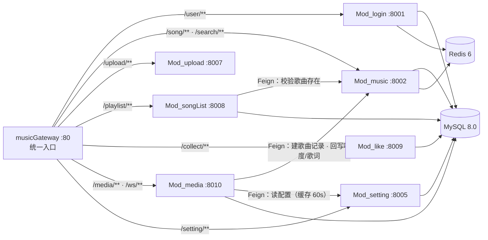

## 2.2 模块职责

| 模块 | 端口 | 服务名 | 职责 |
| --- | --- | --- | --- |
| Gateway | 80 | musicGateway | 路由分发、统一鉴权、限流熔断、跨域 |
| Mod_login | 8001 | loginService8001 | 注册、登录、JWT、用户信息、歌手认证申请与审核 |
| Mod_music | 8002 | musicService8002 | 歌曲 CRUD 与审核、搜索推荐、播放统计、榜单 |
| Mod_upload | 8007 | uploadService8007 | 文件上传校验与落盘 |
| Mod_songList | 8008 | songListService8008 | 歌单管理与收藏 |
| Mod_like | 8009 | likeService8009 | 歌曲收藏、评论点赞 |
| Mod_media | 8010 | mediaService8010 | 下载、转码、响度、转写、字幕、工具与模型管理 |
| Mod_setting | 8005 | settingService8005 | 键值配置中心 |

## 2.3 跨服务调用失败策略

| 调用链 | 场景 | 失败策略 |
| --- | --- | --- |
| Mod_media → Mod_music | 下载完成后建立歌曲记录 | 任务状态回 PENDING，每 30 秒重试，至多 3 次 |
| Mod_media → Mod_setting | 读取工具与处理配置 | 使用本地缓存（不超过 60 秒）兜底 |
| Mod_songList → Mod_music | 添加歌曲前校验存在性 | 返回"数据暂时不可用"，不写入 |
| Gateway → 各服务 | 全部外部请求 | 超时与熔断，返回 1001 服务暂不可用 |
| Mod_login / Mod_music → Redis | 会话与缓存 | 降级直查数据库 |

# 3 数据库详细设计

## 3.1 库表总览

数据库 music 共 19 张表，按五个业务域组织，实体关系分域建模如图 3-1、图 3-2、图 3-3 所示。需求规格说明书规划 17 张核心表，本设计补充两张：公告表 announcement 支撑公告功能（F067—F070），歌曲相似度表 song_similarity 存储协同过滤离线计算结果、支撑个性化推荐（6.2 节）。

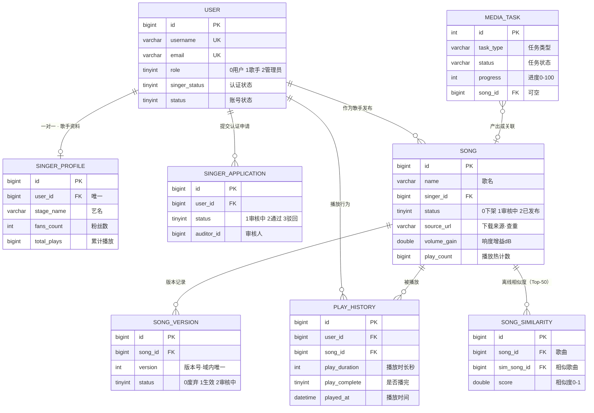

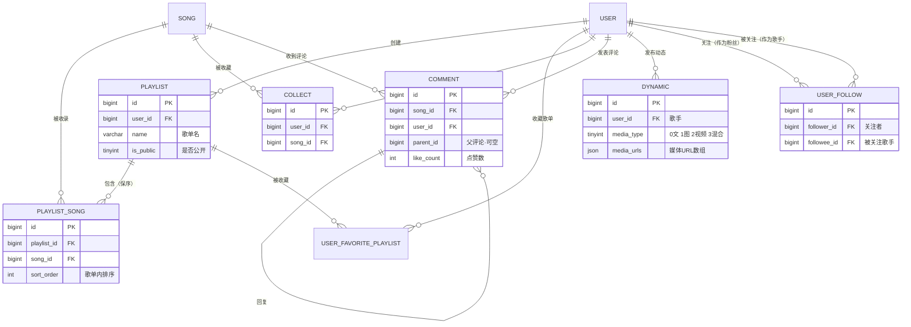

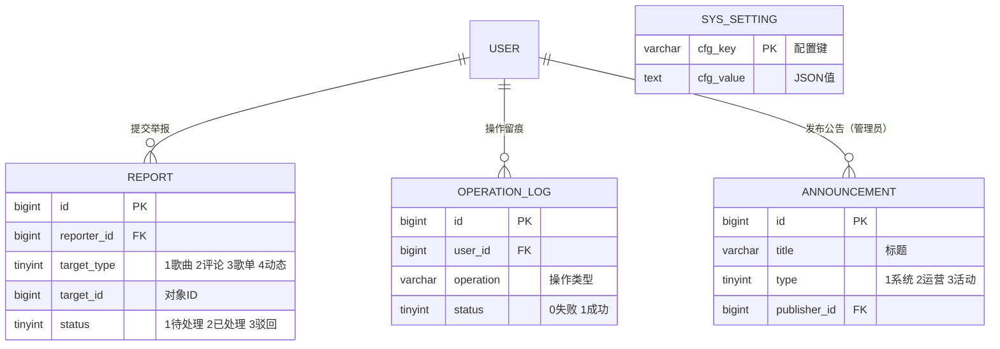

## 3.2 用户域 DDL

用户主表 user 是权限体系根基，角色与认证状态分离存储：

```sql
CREATE TABLE user (
  id            BIGINT       NOT NULL AUTO_INCREMENT COMMENT '用户ID',
  username      VARCHAR(50)  NOT NULL COMMENT '用户名',
  password      VARCHAR(128) NOT NULL COMMENT '密码(BCrypt加密)',
  email         VARCHAR(100) NOT NULL COMMENT '邮箱',
  nickname      VARCHAR(50)  NULL COMMENT '昵称',
  avatar        VARCHAR(255) NULL COMMENT '头像URL',
  role          TINYINT      NOT NULL DEFAULT 0 COMMENT '角色(0普通用户 1认证歌手 2管理员)',
  singer_status TINYINT      NOT NULL DEFAULT 0 COMMENT '歌手认证(0未申请 1审核中 2通过 3驳回)',
  status        TINYINT      NOT NULL DEFAULT 1 COMMENT '账号状态(0禁用 1正常)',
  create_time   DATETIME     NOT NULL DEFAULT CURRENT_TIMESTAMP COMMENT '创建时间',
  update_time   DATETIME     NULL ON UPDATE CURRENT_TIMESTAMP COMMENT '更新时间',
  PRIMARY KEY (id),
  UNIQUE KEY uk_user_username (username),
  UNIQUE KEY uk_user_email (email),
  KEY idx_user_role (role),
  KEY idx_user_singer_status (singer_status),
  KEY idx_user_status (status),
  KEY idx_user_create_time (create_time)
) ENGINE=InnoDB DEFAULT CHARSET=utf8mb4 COMMENT='用户表';
```

歌手资料表与认证申请表：

```sql
CREATE TABLE singer_profile (
  id               BIGINT NOT NULL AUTO_INCREMENT,
  user_id          BIGINT NOT NULL COMMENT '用户ID(唯一)',
  stage_name       VARCHAR(50) NULL COMMENT '艺名',
  bio              TEXT NULL COMMENT '简介',
  background_image VARCHAR(255) NULL COMMENT '背景图URL',
  verified_date    DATETIME NULL COMMENT '认证通过时间',
  fans_count       INT NOT NULL DEFAULT 0 COMMENT '粉丝数',
  total_plays      BIGINT NOT NULL DEFAULT 0 COMMENT '累计播放量',
  create_time      DATETIME NOT NULL DEFAULT CURRENT_TIMESTAMP,
  update_time      DATETIME NULL ON UPDATE CURRENT_TIMESTAMP,
  PRIMARY KEY (id),
  UNIQUE KEY uk_sprofile_user (user_id)
) ENGINE=InnoDB DEFAULT CHARSET=utf8mb4 COMMENT='歌手资料表';

CREATE TABLE singer_application (
  id               BIGINT NOT NULL AUTO_INCREMENT,
  user_id          BIGINT NOT NULL COMMENT '申请用户ID',
  real_name        VARCHAR(50) NOT NULL COMMENT '真实姓名',
  id_card          VARCHAR(255) NOT NULL COMMENT '身份证号(加密存储)',
  id_card_front    VARCHAR(255) NOT NULL COMMENT '证件正面照URL',
  id_card_back     VARCHAR(255) NOT NULL COMMENT '证件反面照URL',
  artist_statement TEXT NULL COMMENT '艺人声明',
  status           TINYINT NOT NULL DEFAULT 1 COMMENT '审核状态(1审核中 2通过 3驳回)',
  reject_reason    VARCHAR(500) NULL COMMENT '驳回原因',
  auditor_id       BIGINT NULL COMMENT '审核人ID',
  audit_time       DATETIME NULL COMMENT '审核时间',
  create_time      DATETIME NOT NULL DEFAULT CURRENT_TIMESTAMP,
  PRIMARY KEY (id),
  KEY idx_sapp_user (user_id),
  KEY idx_sapp_status (status)
) ENGINE=InnoDB DEFAULT CHARSET=utf8mb4 COMMENT='歌手认证申请表';
```

## 3.3 音乐域 DDL

歌曲主表 song 在需求基线上增加媒体管线所需的三个字段：source_url（下载来源查重）、volume_gain（响度补偿增益）、integrated_loudness（原始综合响度）。

```sql
CREATE TABLE song (
  id                  BIGINT NOT NULL AUTO_INCREMENT COMMENT '歌曲ID',
  name                VARCHAR(100) NOT NULL COMMENT '歌曲名称',
  singer_id           BIGINT NOT NULL COMMENT '歌手用户ID',
  album               VARCHAR(100) NULL COMMENT '专辑名称',
  style               VARCHAR(50) NULL COMMENT '风格(流行/摇滚/民谣等)',
  language            VARCHAR(20) NULL COMMENT '语言(国语/英语/日语等)',
  duration            INT NOT NULL DEFAULT 0 COMMENT '时长(秒)',
  file_url            VARCHAR(255) NOT NULL COMMENT '音频文件URL',
  cover_url           VARCHAR(255) NULL COMMENT '封面图片URL',
  lyric_url           VARCHAR(255) NULL COMMENT '歌词文件URL',
  file_format         VARCHAR(10) NOT NULL COMMENT '格式(MP3/FLAC/AAC)',
  play_count          BIGINT NOT NULL DEFAULT 0 COMMENT '播放次数(冗余热计数)',
  collect_count       INT NOT NULL DEFAULT 0 COMMENT '收藏次数',
  status              TINYINT NOT NULL DEFAULT 1 COMMENT '状态(0已下架 1审核中 2已发布,审核制)',
  reject_reason       TEXT NULL COMMENT '审核驳回原因',
  auditor_id          BIGINT NULL COMMENT '审核人ID',
  audit_time          DATETIME NULL COMMENT '审核时间',
  source_url          VARCHAR(512) NULL COMMENT '下载来源URL(查重)',
  volume_gain         DOUBLE NULL COMMENT '响度补偿增益(dB)',
  integrated_loudness DOUBLE NULL COMMENT '原始综合响度(LUFS)',
  create_time         DATETIME NOT NULL DEFAULT CURRENT_TIMESTAMP,
  update_time         DATETIME NULL ON UPDATE CURRENT_TIMESTAMP,
  PRIMARY KEY (id),
  KEY idx_song_name (name),
  KEY idx_song_singer (singer_id),
  KEY idx_song_style (style),
  KEY idx_song_language (language),
  KEY idx_song_status (status),
  KEY idx_song_source (source_url),
  KEY idx_song_create_time (create_time)
) ENGINE=InnoDB DEFAULT CHARSET=utf8mb4 COMMENT='歌曲表';

CREATE TABLE song_version (
  id          BIGINT NOT NULL AUTO_INCREMENT,
  song_id     BIGINT NOT NULL COMMENT '歌曲ID',
  version     INT NOT NULL DEFAULT 1 COMMENT '版本号',
  file_url    VARCHAR(255) NOT NULL COMMENT '音频文件URL',
  file_format VARCHAR(10) NOT NULL COMMENT '音频格式',
  file_size   BIGINT NOT NULL DEFAULT 0 COMMENT '文件大小(字节)',
  duration    INT NOT NULL DEFAULT 0 COMMENT '时长(秒)',
  status      TINYINT NOT NULL DEFAULT 1 COMMENT '版本状态(0已废弃 1生效中 2审核中)',
  create_time DATETIME NOT NULL DEFAULT CURRENT_TIMESTAMP,
  audit_time  DATETIME NULL COMMENT '审核时间',
  auditor_id  BIGINT NULL COMMENT '审核人ID',
  PRIMARY KEY (id),
  UNIQUE KEY uk_sver (song_id, version),
  KEY idx_sver_status (song_id, status)
) ENGINE=InnoDB DEFAULT CHARSET=utf8mb4 COMMENT='歌曲版本表';
```

播放历史与媒体任务表：

```sql
CREATE TABLE play_history (
  id            BIGINT NOT NULL AUTO_INCREMENT,
  user_id       BIGINT NOT NULL COMMENT '用户ID',
  song_id       BIGINT NOT NULL COMMENT '歌曲ID',
  play_duration INT NOT NULL DEFAULT 0 COMMENT '播放时长(秒)',
  play_complete TINYINT NOT NULL DEFAULT 0 COMMENT '是否播完(0否 1是)',
  device_type   VARCHAR(20) NULL COMMENT '设备类型(web/mobile/app)',
  ip_address    VARCHAR(50) NULL COMMENT '播放IP',
  played_at     DATETIME NOT NULL DEFAULT CURRENT_TIMESTAMP COMMENT '播放时间',
  PRIMARY KEY (id),
  KEY idx_ph_user (user_id, played_at),
  KEY idx_ph_song (song_id),
  KEY idx_ph_time (played_at)
) ENGINE=InnoDB DEFAULT CHARSET=utf8mb4 COMMENT='播放历史表';

CREATE TABLE media_task (
  id          INT NOT NULL AUTO_INCREMENT,
  task_type   VARCHAR(20) NOT NULL COMMENT 'DOWNLOAD/TRANSCRIBE/LOUDNESS/SUBTITLE/MODEL_DOWNLOAD/TOOL_UPDATE',
  status      VARCHAR(20) NOT NULL DEFAULT 'PENDING' COMMENT 'PENDING/RUNNING/SUCCESS/FAILED/CANCELLED',
  progress    INT NOT NULL DEFAULT 0 COMMENT '进度(0-100)',
  stage       VARCHAR(200) NULL COMMENT '当前阶段描述(中文,直接展示)',
  source_url  VARCHAR(512) NULL COMMENT '来源URL',
  song_id     BIGINT NULL COMMENT '关联歌曲ID',
  operator    BIGINT NULL COMMENT '发起用户ID',
  error       VARCHAR(1000) NULL COMMENT '转译后的用户可读错误',
  created_at  DATETIME NOT NULL DEFAULT CURRENT_TIMESTAMP,
  finished_at DATETIME NULL COMMENT '完成时间',
  PRIMARY KEY (id),
  KEY idx_task_status (status),
  KEY idx_task_song (song_id)
) ENGINE=InnoDB DEFAULT CHARSET=utf8mb4 COMMENT='媒体任务表';

CREATE TABLE song_similarity (
  id           BIGINT NOT NULL AUTO_INCREMENT,
  song_id      BIGINT NOT NULL COMMENT '歌曲ID',
  sim_song_id  BIGINT NOT NULL COMMENT '相似歌曲ID',
  score        DOUBLE NOT NULL COMMENT '相似度(0-1,调整余弦)',
  update_time  DATETIME NOT NULL DEFAULT CURRENT_TIMESTAMP ON UPDATE CURRENT_TIMESTAMP COMMENT '重算时间',
  PRIMARY KEY (id),
  UNIQUE KEY uk_sim (song_id, sim_song_id),
  KEY idx_sim_score (song_id, score)
) ENGINE=InnoDB DEFAULT CHARSET=utf8mb4 COMMENT='歌曲相似度矩阵(协同过滤离线计算)';
```

song_similarity 由推荐离线任务全量重写（先清后写，见 6.2 节），每首歌仅保留相似度最高的 50 条，在线推荐只读不写。

## 3.4 歌单域 DDL

```sql
CREATE TABLE playlist (
  id          BIGINT NOT NULL AUTO_INCREMENT,
  user_id     BIGINT NOT NULL COMMENT '创建用户ID',
  name        VARCHAR(100) NOT NULL COMMENT '歌单名称',
  description VARCHAR(500) NULL COMMENT '歌单描述',
  cover_url   VARCHAR(255) NULL COMMENT '封面图片URL',
  is_public   TINYINT NOT NULL DEFAULT 1 COMMENT '是否公开(0私有 1公开)',
  create_time DATETIME NOT NULL DEFAULT CURRENT_TIMESTAMP,
  update_time DATETIME NULL ON UPDATE CURRENT_TIMESTAMP,
  PRIMARY KEY (id),
  KEY idx_pl_user (user_id)
) ENGINE=InnoDB DEFAULT CHARSET=utf8mb4 COMMENT='歌单表';

CREATE TABLE playlist_song (
  id          BIGINT NOT NULL AUTO_INCREMENT,
  playlist_id BIGINT NOT NULL COMMENT '歌单ID',
  song_id     BIGINT NOT NULL COMMENT '歌曲ID',
  sort_order  INT NOT NULL DEFAULT 0 COMMENT '排序序号',
  create_time DATETIME NOT NULL DEFAULT CURRENT_TIMESTAMP,
  PRIMARY KEY (id),
  UNIQUE KEY uk_ps (playlist_id, song_id),
  KEY idx_ps_order (playlist_id, sort_order)
) ENGINE=InnoDB DEFAULT CHARSET=utf8mb4 COMMENT='歌单歌曲关联表';

CREATE TABLE user_favorite_playlist (
  id          BIGINT NOT NULL AUTO_INCREMENT,
  user_id     BIGINT NOT NULL COMMENT '用户ID',
  playlist_id BIGINT NOT NULL COMMENT '歌单ID',
  create_time DATETIME NOT NULL DEFAULT CURRENT_TIMESTAMP,
  PRIMARY KEY (id),
  UNIQUE KEY uk_ufp (user_id, playlist_id)
) ENGINE=InnoDB DEFAULT CHARSET=utf8mb4 COMMENT='用户收藏歌单表';

CREATE TABLE collect (
  id          BIGINT NOT NULL AUTO_INCREMENT,
  user_id     BIGINT NOT NULL COMMENT '用户ID',
  song_id     BIGINT NOT NULL COMMENT '歌曲ID',
  create_time DATETIME NOT NULL DEFAULT CURRENT_TIMESTAMP,
  PRIMARY KEY (id),
  UNIQUE KEY uk_collect (user_id, song_id),
  KEY idx_collect_song (song_id)
) ENGINE=InnoDB DEFAULT CHARSET=utf8mb4 COMMENT='歌曲收藏表';
```

## 3.5 社交域 DDL

```sql
CREATE TABLE comment (
  id          BIGINT NOT NULL AUTO_INCREMENT,
  song_id     BIGINT NOT NULL COMMENT '歌曲ID',
  user_id     BIGINT NOT NULL COMMENT '评论用户ID',
  parent_id   BIGINT NULL COMMENT '父评论ID(顶层评论为NULL)',
  content     TEXT NOT NULL COMMENT '评论内容',
  like_count  INT NOT NULL DEFAULT 0 COMMENT '点赞数',
  status      TINYINT NOT NULL DEFAULT 1 COMMENT '状态(0删除 1正常 2审核中)',
  create_time DATETIME NOT NULL DEFAULT CURRENT_TIMESTAMP,
  update_time DATETIME NULL ON UPDATE CURRENT_TIMESTAMP,
  PRIMARY KEY (id),
  KEY idx_cmt_song (song_id, create_time),
  KEY idx_cmt_user (user_id, create_time),
  KEY idx_cmt_parent (parent_id)
) ENGINE=InnoDB DEFAULT CHARSET=utf8mb4 COMMENT='评论表';

CREATE TABLE dynamic (
  id            BIGINT NOT NULL AUTO_INCREMENT,
  user_id       BIGINT NOT NULL COMMENT '发布用户ID(歌手)',
  content       TEXT NULL COMMENT '文字内容',
  media_type    TINYINT NOT NULL DEFAULT 0 COMMENT '媒体类型(0纯文字 1图片 2视频 3混合)',
  media_urls    JSON NULL COMMENT '媒体文件URL数组',
  like_count    INT NOT NULL DEFAULT 0 COMMENT '点赞数',
  comment_count INT NOT NULL DEFAULT 0 COMMENT '评论数',
  share_count   INT NOT NULL DEFAULT 0 COMMENT '分享数',
  status        TINYINT NOT NULL DEFAULT 1 COMMENT '状态(0删除 1正常 2审核中)',
  create_time   DATETIME NOT NULL DEFAULT CURRENT_TIMESTAMP,
  update_time   DATETIME NULL ON UPDATE CURRENT_TIMESTAMP,
  PRIMARY KEY (id),
  KEY idx_dyn_user (user_id, create_time),
  KEY idx_dyn_time (create_time)
) ENGINE=InnoDB DEFAULT CHARSET=utf8mb4 COMMENT='歌手动态表';

CREATE TABLE user_follow (
  id          BIGINT NOT NULL AUTO_INCREMENT,
  follower_id BIGINT NOT NULL COMMENT '关注者ID',
  followee_id BIGINT NOT NULL COMMENT '被关注者ID(歌手)',
  create_time DATETIME NOT NULL DEFAULT CURRENT_TIMESTAMP,
  PRIMARY KEY (id),
  UNIQUE KEY uk_follow (follower_id, followee_id),
  KEY idx_follow_followee (followee_id)
) ENGINE=InnoDB DEFAULT CHARSET=utf8mb4 COMMENT='用户关注表';
```

## 3.6 运营域 DDL

```sql
CREATE TABLE report (
  id            BIGINT NOT NULL AUTO_INCREMENT,
  reporter_id   BIGINT NOT NULL COMMENT '举报人ID',
  target_type   TINYINT NOT NULL COMMENT '对象类型(1歌曲 2评论 3歌单 4动态)',
  target_id     BIGINT NOT NULL COMMENT '对象ID',
  reason        TINYINT NOT NULL COMMENT '原因(1侵权 2违规内容 3垃圾信息 4其他)',
  description   TEXT NULL COMMENT '详细描述',
  status        TINYINT NOT NULL DEFAULT 1 COMMENT '处理状态(1待处理 2已处理 3已驳回)',
  handler_id    BIGINT NULL COMMENT '处理人ID',
  handle_result TEXT NULL COMMENT '处理结果说明',
  create_time   DATETIME NOT NULL DEFAULT CURRENT_TIMESTAMP,
  handle_time   DATETIME NULL COMMENT '处理时间',
  PRIMARY KEY (id),
  KEY idx_rpt_reporter (reporter_id, create_time),
  KEY idx_rpt_target (target_type, target_id),
  KEY idx_rpt_status (status, create_time)
) ENGINE=InnoDB DEFAULT CHARSET=utf8mb4 COMMENT='举报表';

CREATE TABLE operation_log (
  id          BIGINT NOT NULL AUTO_INCREMENT,
  user_id     BIGINT NULL COMMENT '操作用户ID',
  username    VARCHAR(50) NULL COMMENT '操作用户名',
  operation   VARCHAR(50) NOT NULL COMMENT '操作类型(LOGIN/UPLOAD/DELETE/EDIT等)',
  method      VARCHAR(10) NULL COMMENT '请求方法',
  params      TEXT NULL COMMENT '请求参数',
  ip          VARCHAR(50) NULL COMMENT '操作IP',
  location    VARCHAR(100) NULL COMMENT '操作地点',
  browser     VARCHAR(100) NULL COMMENT '浏览器类型',
  status      TINYINT NOT NULL DEFAULT 1 COMMENT '操作状态(0失败 1成功)',
  error_msg   VARCHAR(1000) NULL COMMENT '错误信息',
  create_time DATETIME NOT NULL DEFAULT CURRENT_TIMESTAMP,
  PRIMARY KEY (id),
  KEY idx_oplog_user (user_id, create_time)
) ENGINE=InnoDB DEFAULT CHARSET=utf8mb4 COMMENT='操作日志表';

CREATE TABLE announcement (
  id           BIGINT NOT NULL AUTO_INCREMENT,
  title        VARCHAR(200) NOT NULL COMMENT '公告标题',
  content      TEXT NOT NULL COMMENT '公告内容',
  type         TINYINT NOT NULL DEFAULT 1 COMMENT '类型(1系统 2运营 3活动)',
  publisher_id BIGINT NOT NULL COMMENT '发布管理员ID',
  status       TINYINT NOT NULL DEFAULT 1 COMMENT '状态(0下线 1发布)',
  create_time  DATETIME NOT NULL DEFAULT CURRENT_TIMESTAMP,
  update_time  DATETIME NULL ON UPDATE CURRENT_TIMESTAMP,
  PRIMARY KEY (id),
  KEY idx_ann_type (type),
  KEY idx_ann_status (status)
) ENGINE=InnoDB DEFAULT CHARSET=utf8mb4 COMMENT='系统公告表';

CREATE TABLE sys_setting (
  cfg_key    VARCHAR(100) NOT NULL COMMENT '配置键',
  cfg_value  TEXT NOT NULL COMMENT '配置值(JSON)',
  updated_at DATETIME NOT NULL DEFAULT CURRENT_TIMESTAMP ON UPDATE CURRENT_TIMESTAMP,
  PRIMARY KEY (cfg_key)
) ENGINE=InnoDB DEFAULT CHARSET=utf8mb4 COMMENT='系统配置表';
```

## 3.7 索引与约束设计原则

索引按查询模式设计，而非按字段逐个加索引：复合索引 (user_id, played_at) 支撑播放历史与偏好统计，(song_id, create_time) 支撑歌曲评论列表，(playlist_id, sort_order) 支撑歌单保序输出，(target_type, target_id) 支撑举报对象聚合。业务防重一律用唯一约束（用户名、邮箱、收藏、关注、歌单收录、版本号），而非应用层先查后写。冗余热计数（play_count、collect_count、fans_count）与明细在同一事务内更新，以明细表为准可重算。物理外键不建，引用完整性由服务层校验，便于批量操作与未来分库。

# 4 API 网关详细设计

## 4.1 路由表

| 路由规则 | 目标服务 | 说明 |
| --- | --- | --- |
| Path=/api/v1/user/** | loginService8001 | 用户认证与信息 |
| Path=/api/v1/song/**、/api/v1/search/** | musicService8002 | 歌曲与搜索 |
| Path=/api/v1/upload/** | uploadService8007 | 文件上传 |
| Path=/api/v1/playlist/** | songListService8008 | 歌单 |
| Path=/api/v1/collect/** | likeService8009 | 收藏点赞 |
| Path=/api/v1/media/**、Path=/ws/** | mediaService8010 | 媒体任务与 WebSocket |
| Path=/api/v1/setting/** | settingService8005 | 系统配置 |

## 4.2 请求处理流程

每个进入网关的请求依次经过限流、白名单、令牌校验、角色校验四道关卡，通过后才透传用户身份并路由至下游，流程如图 4-1 所示。

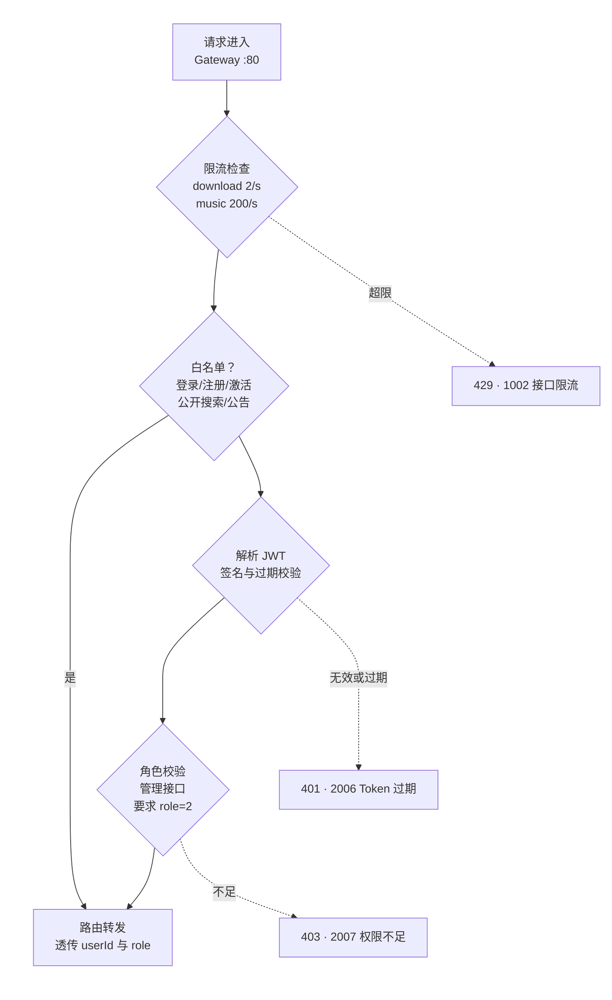

白名单之外的全部请求必须携带有效 JWT。限流基于 Redis 计数按用户维度与接口维度双轨执行，超限直接返回 429 与错误码 1002，不触达下游。全局异常处理器把路由失败、下游超时、熔断打开统一包装为标准错误体（1000/1001），不向前端泄漏堆栈。

# 5 Mod_login 用户认证服务详细设计

## 5.1 功能与流程

承载注册与激活（F001—F002）、登录（F003）、找回密码（F004）、用户信息维护（F014—F016）与歌手认证（F048）。

注册流程：提交用户名、邮箱与密码；服务校验用户名与邮箱唯一性（重复返回 2002）；密码 BCrypt 加密落库，新账号默认 role=0、status=1；生成 24 小时有效的一次性激活令牌写 Redis 并发送激活邮件；未激活账号登录时返回 2004（邮箱未验证）。

登录流程：依次校验账号存在（2001）、状态正常（2005）、密码匹配（2003），通过后签发 JWT 并写 operation_log。Token 失效支持两种途径：自然过期（24 小时，记住登录 7 天）与主动失效（登出时删除 Redis 会话记录）。

## 5.2 JWT 设计

| 项 | 设计 |
| --- | --- |
| 载荷字段 | userId、username、role、exp（过期时间戳） |
| 签名算法 | HS256，密钥经 Nacos 配置中心下发 |
| 有效期 | 24 小时；勾选记住登录为 7 天 |
| 传递方式 | Authorization 请求头 |
| 校验位置 | 网关统一校验；服务内不重复解析（读透传头） |
| 主动失效 | Redis 会话记录，登出即删 |

## 5.3 歌手认证状态流转

认证状态机如图 5-1 所示：申请把 singer_status 从未申请推进到审核中，审核结果决定通过（角色同步升级为歌手）或驳回（可修改后重新申请）。

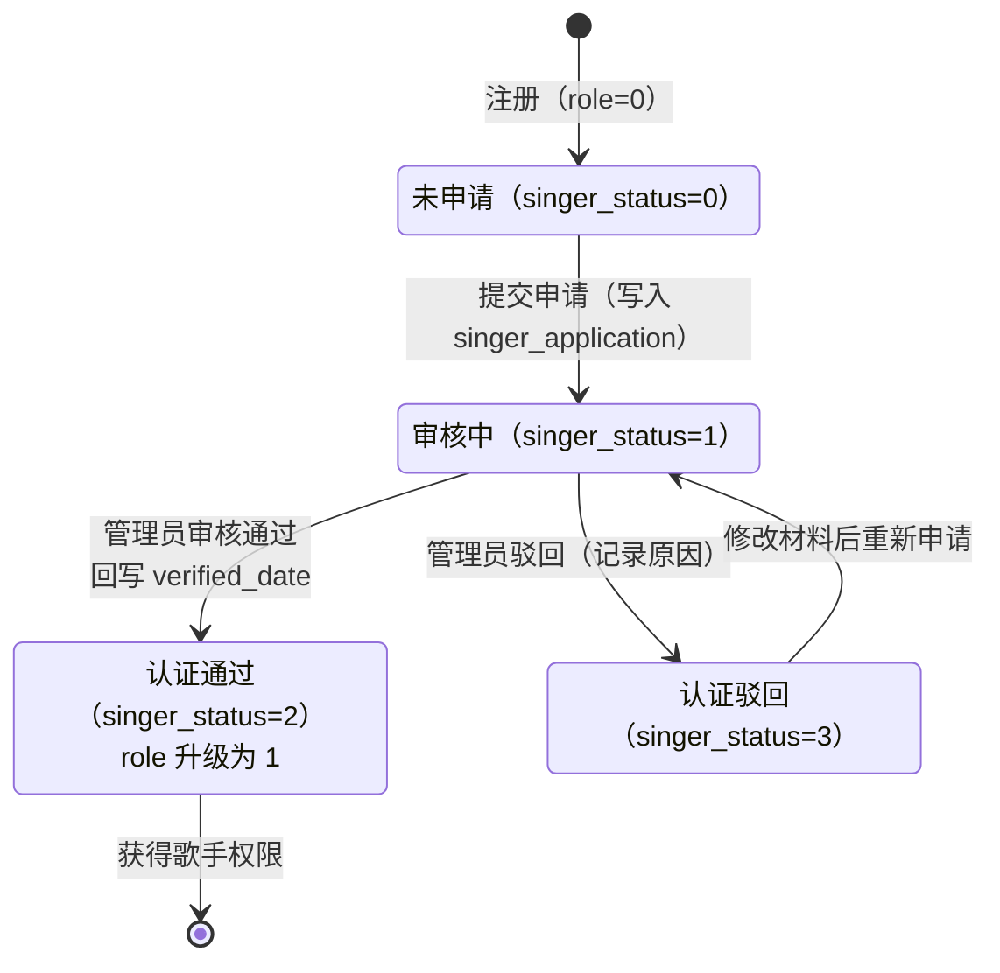

同一用户同时只允许一个活跃申请，提交时若存在未完结申请则拒绝（避免审核积压重复单）。

## 5.4 接口清单

| 接口 | 方法 | 鉴权 | 说明 |
| --- | --- | --- | --- |
| /user/register | POST | 匿名 | 注册并发送激活邮件 |
| /user/activate | GET | 匿名 | 激活令牌校验 |
| /user/login | POST | 匿名 | 返回 token 与用户信息 |
| /user/password/reset | POST | 匿名 | 邮箱找回密码 |
| /user/password/change | POST | 登录 | 校验旧密码后修改 |
| /user/info | GET/PUT | 登录 | 查询/修改基本信息 |
| /user/singer/apply | POST | 登录 | 提交歌手认证申请 |
| /user/singer/audit | POST | 管理员 | 审核认证（通过/驳回） |
| /user/list、/user/status | GET/POST | 管理员 | 用户列表与禁用/启用 |

# 6 Mod_music 音乐业务服务详细设计

## 6.1 歌曲审核状态机

发布策略为**审核制**（对应需求规格说明书 7.3 节）：上传主体（歌手与管理员）无论走本地文件上传还是链接导入，歌曲入库一律进入审核中（status=1），管理员审核通过后发布（status=2）、全站公开可播；驳回保持 status=1 并记录 reject_reason，上传者修改后可重新提交；已发布歌曲违规时下架（status=0）并可重新上架。状态机如图 6-1 所示。

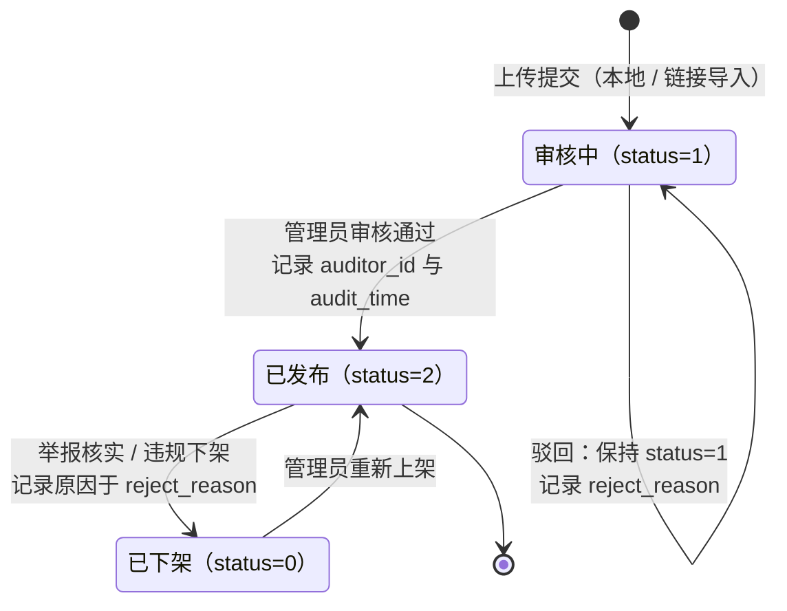

设计说明：reject_reason 字段语义为驳回或下架原因，供修改重提与管理复核。播放接口按状态拦截：审核中返回 3002，已下架返回 3003，不存在返回 3001。违规处理链路：下架、记录原因、降低歌手信誉分，情节严重时禁用歌手账户并站内通知。版本替换（F118—F122）仍走 song_version 审核中状态，替换文件经管理员确认后生效，与主状态机独立。

管理操作补齐（2026-08-21）：管理员可删除歌曲（POST /song/delete/{id}），连带清理 song_version、comment、collect，播放历史保留用于统计审计，删除后失效热榜缓存。榜单与管理列表的卡片字段补齐 duration（热榜 CARD_COLS 与周榜 SQL 联表带出），前端不再显示 00:00；存量歌曲时长已用 ffprobe 按实际音频回填。任何可见性变化（发布/下架/上架/删除）均按前缀失效 chart:hot:{limit} 缓存，用户端即时生效。

## 6.2 搜索与推荐设计

搜索（F006—F009）走 MySQL 索引：歌名与歌手名前缀匹配用 name 与 singer 索引，分类浏览按 style、language 过滤，统一分页返回；搜索历史（F013）存 Redis，每用户保留最近 20 条。

推荐（F010—F012）采用**基于物品的协同过滤（Item-based CF）**。选型理由：音乐场景歌曲基数增长慢于用户基数，歌曲相似度矩阵离线算一次即可服务全部用户；推荐结果可解释（因用户听过某首歌而推荐相似歌曲）；在线阶段只做查表聚合，满足 500ms 性能指标。相比之下 User-based 需要实时寻找邻居用户，评分矩阵稀疏时结果不稳定。

算法分四步实施：

**第一步，评分矩阵构建（隐式反馈）。** 以 play_history 为数据源，播完才计的口径保证行为可信；按（用户，歌曲）聚合播放次数并做对数压缩得评分 r(u,i) = log(1 + count)，压缩高频循环播放的影响；收藏行为（collect 表存在记录）额外加 1，表达更强偏好。

**第二步，相似度离线计算。** 每日 03:00 定时任务全量重算：采用调整余弦相似度（减去用户均分，消除重度用户的高分偏置），对歌曲 i 与 j，在同时听过二者的用户集合上累加去均值评分的乘积，除以两边去均值评分模长的乘积；仅对共同听众不少于 3 人的歌曲对计算，过滤噪声。每首歌保留得分最高的 50 条，先清后写 song_similarity 表。

**第三步，在线推荐（查表聚合）。** 取用户近 90 天播放过的歌曲，按时间指数衰减加权（每满 30 天权重减半）；逐首拉取其 Top-50 相似歌曲，候选得分为相似度与偏好权重的乘积累加；过滤用户已听过的歌曲后取前 10 首；整体结果写 Redis 缓存 10 分钟，短时重复请求不重算。

**第四步，冷启动兜底。** 用户播放记录不足 10 条时直接返回全站热门榜；候选不足 10 首（新歌暂无相似数据）时以同歌手热门与同风格热门补齐。

工程要点：课设数据量（万级播放明细）下离线计算内存即可完成；重算任务加分布式锁防止重复执行（多实例演进时改分片）；推荐接口与榜单共用 Redis，缓存故障时降级热门榜，链路不中断。

## 6.3 播放统计体系

口径为播完才计：前端 audio 元素播放结束事件触发上报，服务端在同一事务内完成明细与热计数两次写入；播放明细同时是协同过滤推荐的评分数据源（6.2 节）：

```sql
-- 同一事务
INSERT INTO play_history (user_id, song_id, play_duration, play_complete, device_type, ip_address, played_at)
VALUES (?, ?, ?, 1, ?, ?, NOW());
UPDATE song SET play_count = play_count + 1 WHERE id = ?;
```

统计接口设计：

| 接口 | 说明 | 实现要点 |
| --- | --- | --- |
| GET /music/recent?limit=50 | 最近播放（去重取最新） | 关联 play_history 按歌曲分组取最大播放时间倒序 |
| GET /music/history?page&size | 播放明细分页 | 走 (user_id, played_at) 复合索引 |
| GET /music/chart?type=hot | 全站热门榜 | 按 play_count 排序，Redis 缓存 10 分钟 |
| GET /music/chart?type=rise | 周榜 | play_history 近 7 天按歌曲计数分组 |

明细每日定时清理，仅保留最近 1 万条：

```sql
DELETE FROM play_history WHERE id NOT IN (
  SELECT id FROM (
    SELECT id FROM play_history ORDER BY played_at DESC LIMIT 10000
  ) t
);
```

## 6.4 响度数据下发

播放接口 GET /song/play/{id} 在常规字段外下发 volumeGain（来自 song.volume_gain，未分析时为空）。前端按公式 volume = base × 10^(gain ÷ 20) 换算并限制在 0 到 1 之间，实现跨歌曲音量均衡；无增益数据时回退原始音量。

# 7 Mod_upload 文件上传服务详细设计

## 7.1 上传主体与校验链

上传主体为**歌手与管理员（role ≥ 1）**，普通用户不开放任何上传入口；上传产出的歌曲进入审核流程，管理员审核通过后全站公开（6.1 节）。校验链五步串行，任一步失败立即拒绝并返回对应错误码，如表 7-1 所示。

| 文件类型 | 大小上限 | 格式校验 | 内容安全 | 失败错误码 |
| --- | --- | --- | --- | --- |
| 音频文件 | 50MB | 扩展名白名单 + 文件头 Magic 校验 | 病毒扫描，进入人工审核 | 4001 / 4002 / 3004 |
| 封面图片 | 5MB | JPG、PNG 格式验证 | 内容审核 + 去重检查 | 4001 / 4002 / 4003 |
| 歌词文件 | 1MB | LRC 格式验证 | 敏感词过滤 | 4001 / 4002 |
| 视频动态 | 500MB | 视频格式验证 | 转码 + 病毒扫描 | 4001 / 4002 / 4004 |

文件头 Magic 校验用于拦截伪造扩展名的文件（例如把可执行文件改名为 mp3）；去重检查对图片内容计算摘要，避免重复封面占满存储。

## 7.2 存储规范

按类型分目录：/data/music 存音频、/data/image 存封面、/data/lyric 存歌词、/data/task 存任务临时文件，命名统一以业务 ID 为主键（如 1001.mp3）。存储根目录由配置项 storage_root 控制，生产期切换为 OSS 上传。删除歌曲必须删除全套资源（音频、封面、歌词、数据库记录与关联数据），防止孤儿文件；危险操作前端二次确认。

# 8 Mod_songList 歌单服务详细设计

承载 F023—F030。核心规则：创建歌单校验名称非空；添加歌曲先经 Feign 校验歌曲存在且已发布，再写 playlist_song 并以当前最大 sort_order 加一保序；歌单内查询按 (playlist_id, sort_order) 复合索引有序返回；移除歌曲删除关联行并压缩序号；删除歌单级联清理关联表。可见性控制：公开歌单（is_public=1）可被搜索与收藏，私有歌单仅创建者可见；收藏经唯一约束防重。

接口清单：POST /playlist/create、PUT /playlist/update、DELETE /playlist/{id}、POST /playlist/{id}/songs、DELETE /playlist/{id}/songs/{songId}、GET /playlist/my、POST 与 DELETE /playlist/{id}/favorite。

# 9 Mod_like 收藏点赞服务详细设计

歌曲收藏（F019—F022）写 collect 表，唯一约束 (user_id, song_id) 防重复收藏，同一事务内增减 song.collect_count 冗余计数；收藏列表按收藏时间倒序分页，支持按歌手与风格筛选。

评论点赞（F091）对 comment.like_count 做原子自增（UPDATE ... SET like_count = like_count + 1），点赞人与评论的关联记录存 Redis Set（7 天过期）用于防重与取消点赞；缓存过期后以评论数为准补偿校验。

接口清单：POST /collect/add、DELETE /collect/{songId}、GET /collect/list、POST 与 DELETE /comment/{id}/like。

# 10 Mod_media 媒体处理服务详细设计

## 10.1 进程执行器

进程执行器是全部外部工具调用的唯一出口，接口定义：

```java
CompletableFuture<ExecResult> run(List<String> cmd, long timeoutMs,
                                  Consumer<String> onLine, String cancelKey);
// ExecResult { int exitCode; String stdout; String stderr; boolean timedOut; }
```

六条强约束及其设计依据如表 10-1 所示，前五条来自源项目实测教训，第六条为 Windows 环境编码治理要求。

| 序号 | 约束 | 设计要求 | 违反后果 |
| --- | --- | --- | --- |
| 一 | 数组参数 | 命令以参数数组传递，禁止拼接 Shell 字符串 | 文件名中的引号、连接符等特殊字符被 Shell 解释为命令语法，造成注入与执行失败 |
| 二 | 全异步 | ProcessBuilder 配合 CompletableFuture 调用，禁止同步阻塞等待 | 子进程卡死时拖垮整个服务的请求线程 |
| 三 | stderr 必须收集 | stderr 单独完整收集，不与 stdout 混流 | ffmpeg 响度分析结果只输出在 stderr，丢失后无法解析响度值 |
| 四 | stdout 按行回调且设缓冲上限 | 逐行回调用于解析进度；累计缓冲设置内存上限 | 元数据导出（dump-json 模式）产生超大输出时内存耗尽 |
| 五 | 超时强杀与取消清理 | 超时由定时器强制结束进程；取消时结束登记进程并清理带 _temp 标记的半成品文件 | 僵尸进程累积与临时文件无限堆积占满磁盘 |
| 六 | 编码统一且双流分离 | 子进程输出统一按 UTF-8 解码；stdout 与 stderr 分别收集 | Windows 环境中文乱码导致进度与错误解析失败 |

进度节流：行回调解析出的进度值以不低于 500 毫秒的间隔写 media_task，避免高频更新打爆数据库。

## 10.2 任务状态机与自愈

六类任务与超时如表 10-2 所示，状态机如图 10-1 所示：状态单向流转、不重复消费，写入失败允许有限回退重试。

| 任务类型 | 说明 | 超时 |
| --- | --- | --- |
| DOWNLOAD | 音视频下载 | 20 分钟 |
| TRANSCRIBE | AI 语音转文字 | 30 分钟 |
| LOUDNESS | 响度分析 | 10 分钟 |
| SUBTITLE | 字幕下载转换 | 5 分钟 |
| MODEL_DOWNLOAD | AI 模型下载 | 60 分钟 |
| TOOL_UPDATE | 工具自动更新 | 10 分钟 |

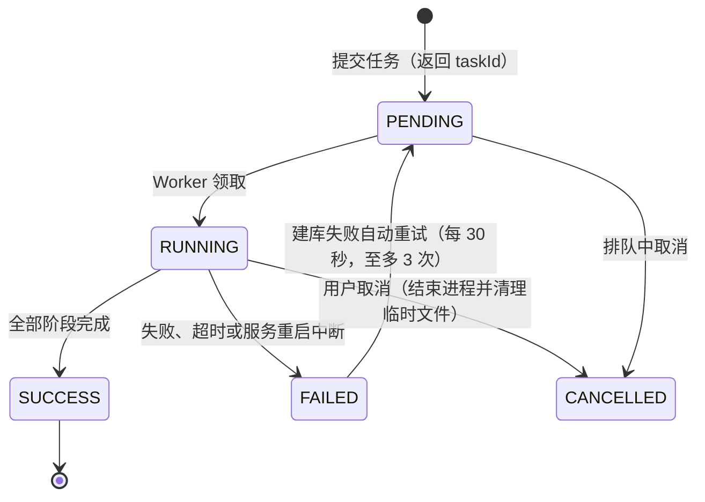

服务重启时的自愈流程如图 10-2 所示，核心是"进程可死、任务状态不丢"：任务表为唯一事实源，启动时按状态分类处置。

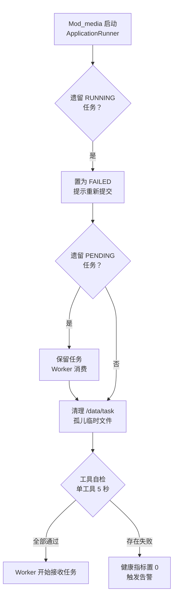

并发控制：下载任务单并发（降低外部站点风控触发概率）；转写并发为 CPU 核数减一；子进程强注册强回收，存活进程数指标兜底防泄漏。

## 10.3 工具与模型管理

管理补齐（2026-08-21）：工具清单加入 ffprobe（与 ffmpeg、yt-dlp、whisper 一起纳入状态页），ffmpeg/ffprobe 二进制随项目放在 tools/bin；各工具版本探测参数按构建定制——ffmpeg/ffprobe 用 -version，whisper-cli 不支持 --version 改用 --help 探活，无版本号的构建展示友好文案。模型状态语义修正：使用中 = 当前选中且模型文件真实存在，未下载的规格显示未下载并给下载按钮，切换前校验文件已下载。管理端全量歌曲页补编辑功能（歌名/专辑/风格/语言，PUT /song/edit/{id}），上传表单补可选的封面图片与 LRC 歌词文件上传（/upload/image、/upload/lyric）。

**工具探测（ToolsLocator）。** 按三级顺序定位可执行文件：

1. 配置项 tools_path 显式指定（绝对路径或相对项目根）；
2. **项目根 tools/ 约定目录（默认约定）**——fetch-tools 脚本拉取的工具统一存放于此，全队路径一致；
3. 系统 PATH 兜底（个别队友偏好全局安装时仍可命中）。

启动自检异步执行（单工具 5 秒超时），结果写内存缓存并暴露健康指标 media_tool_alive，失败告警。

**工具获取（fetch-tools 脚本，团队协作机制）。** 仓库提供 scripts/fetch-tools.js 与工具清单 tools.manifest.json（清单进 Git、二进制不进 Git），队友 clone 后执行一次即可就绪：

```bash
node scripts/fetch-tools.js            # 拉取 yt-dlp、ffmpeg、whisper-cli
node scripts/fetch-tools.js --models   # 追加拉取 whisper 模型（可选）
```

清单字段与拉取规则：每项工具声明名称、锁定版本、平台下载地址（Windows 优先）、目标相对路径与最小体积校验。三个来源：yt-dlp 取 GitHub Releases 单文件（约 17MB）；ffmpeg 取 gyan.dev essentials 压缩包（解压取 bin 下可执行文件）；whisper-cli 取 whisper.cpp Releases，模型取 hf-mirror 镜像。下载复用工具更新机制的可靠逻辑：流式写入 .part 临时文件、失败自动切换镜像源、体积校验后转正。团队约定：tools/ 目录整体写入 .gitignore；工具版本由清单统一锁定，避免"我机器上能跑"的环境漂移。

**版本检查三时机。** 服务启动后 30 秒（异步静默）、每日 09:00 定时、管理员手动查询。检查方式：本地版本号与 GitHub Releases 最新版本号比对（yt-dlp 版本号即日期，可直接比较）；ffmpeg 版本稳定，不纳入自动更新。

**自动更新（TOOL_UPDATE 任务）。** 管理员确认后执行四步：流式下载到临时文件（以 .part 为后缀，按响应长度计算进度，失败自动切换镜像源）；校验体积大于 5MB 拦截半截文件与错误页；原子替换（旧文件改名备份，临时文件转正，更新落位于 tools/ 目录）后执行版本查询验证，验证失败回滚备份；成功后发送管理员站内信并记录更新成败指标。

**whisper 模型管理。** 四种规格：tiny 约 75MB（试水）、base 约 142MB（默认）、small 约 466MB（高精度）、medium 约 1.5GB（最高精度，速度慢）。两条铁律：下载必须管理员确认规格后触发，绝不静默下载；下载走镜像源流式写入 .part 临时文件、校验体积后转正登记。切换规格仅更新配置项，下次任务生效；非当前使用规格可删除释放空间。模型文件是跨平台数据文件，队友之间可直接复制共享（如放入 tools/models/），也可各自经管理页下载。

## 10.4 下载管线（DOWNLOAD 任务）

提交与查重：POST /media/download 提交来源链接与两个开关（是否要字幕、是否要转写）。服务先做 URL 识别（支持 B 站视频页、短链、BV 号、av 号与 YouTube 常见链接形态，正则族匹配；粘贴整段分享文案时先定位 http/www 起始截取纯链接，标题与备注自动剔除，前后端各做一次），不支持的链接返回 400；再按 source_url 查重，已下载过的直接返回 409 与既有歌曲 ID（前端跳转播放）；通过后创建 PENDING 任务并立即返回 taskId。执行阶段如图 10-3 所示。

入库与鉴权口径：经下载管线产出的歌曲入库置为审核中（status=1），管理员审核通过后全站公开可播，与歌手端本地上传同一套审核状态机（6.1 节）。上传主体为歌手与管理员——提交接口（POST /media/download）在网关路由层校验 role ≥ 1，普通用户仅可收听。第⑤步入库时的 fileUrl 指向 task 临时文件，落位 music/{songId}.mp3 后经内部接口 POST /song/internal/file 回写正式音频与封面地址（封面同步落位 image/{songId}.jpg），避免临时目录清理后歌曲不可播。

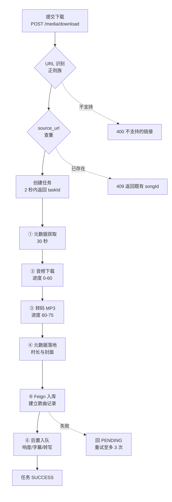

网络参数统一注入：每个 yt-dlp 命令必带浏览器 User-Agent；B 站链接附加 B 站 Referer、YouTube 链接附加对应 Referer；配置了代理则追加代理参数；配置了用户级 cookies 文件则最高优先使用；否则 B 站链接自动获取匿名 cookie（见 10.5 节）。任意阶段取消：结束进程、删除本任务全部临时文件、状态置 CANCELLED。

## 10.5 B 站 412 风控应对

老版本 yt-dlp 或无 cookie 请求 B 站接口会触发 HTTP 412 风控拦截（表现为"以前能下载现在不行"）。两层防护缺一不可：

1. 版本层：yt-dlp 保持最新（10.3 节自动更新机制保障）。
2. Cookie 层：自动获取匿名 buvid cookie 并缓存 1 小时。请求 B 站指纹接口（携带浏览器 UA 与 Referer）取得两个 cookie 值，按 Netscape 标准格式（制表符分隔）写入本地 cookies 文件，后续命令统一追加该文件参数。

工具的原始错误输出绝不直接给用户，一律经转译表映射，如表 10-3 所示。

| 原始错误特征 | 转译后的用户提示 |
| --- | --- |
| 412 / Precondition | 站点风控拦截，请稍后重试；反复出现请配置代理 |
| 403 | 站点拒绝访问，可能需要登录（请在设置中配置 cookies 文件） |
| timeout / 超时 | 网络超时，请检查网络或代理设置 |
| Video unavailable | 视频不存在或已删除 |
| Private video | 视频为私有，无法下载 |

## 10.6 响度分析（EBU R128）

分析命令调用 ffmpeg 的 ebur128 响度滤波器，结果输出在 stderr（对应约束三）。解析采用两级正则：先匹配汇总段的综合响度值，失败则兜底匹配任意 I 值行。增益计算：gain = 目标响度（默认 -16 LUFS）- 实测综合响度，回写 song 表两个响度字段。

三种触发时机：下载管线后置自动入队、手动单曲分析、管理员批量分析（筛选响度字段为空的歌曲）。修改目标响度无需重新分析，按公式批量重算增益即可。播放端按 6.4 节公式应用增益。

## 10.7 AI 转写与字幕

**转写（TRANSCRIBE）。** 对存量歌曲同样适用，无需重传文件，四步执行：

1. 预处理：ffmpeg 转为 16kHz 单声道 WAV（识别引擎的输入要求）。
2. 识别：whisper 引擎加载当前规格模型，语言设为自动检测，输出 LRC 格式歌词并实时输出进度百分比行。
3. 入库：歌词文件落至歌词目录并回写 song.lyric_url。
4. 清理：删除 WAV 临时文件。

模型未下载时任务置 FAILED 并提示先在设置中下载模型——对应需求 F042-1 的降级策略：发布流程不被转写阻塞，仅在消息中提示。

**字幕下载（SUBTITLE）。** 以跳过下载模式仅拉取字幕轨，语言优先级为简中、中文、英文；无字幕则正常结束不算失败，前端提示可改用 AI 识别。

**字幕转 LRC。** 三种格式统一转换：SRT 跳过序号行、取时间轴起始时间、拼接正文；VTT 跳过文件头，其余同 SRT；ASS 解析对话行、取起始时间、剥除特效标签。时间统一为分:秒.厘秒格式并按时间排序；无时间标签的纯文本按行保留、由前端整段展示。

## 10.8 API 汇总

| 接口 | 方法 | 鉴权 | 说明 |
| --- | --- | --- | --- |
| /media/download | POST | 歌手或管理员 | 提交下载任务返回 taskId；重复返回 409 |
| /media/task/{id} | GET | 登录 | 查询状态、进度、阶段与错误 |
| /media/task/{id}/cancel | POST | 登录 | 取消任务并清理临时文件 |
| /media/transcribe/{songId} | POST | 登录 | 存量歌曲 AI 转写 |
| /media/loudness/{songId} | POST | 登录 | 单曲响度分析 |
| /media/loudness/batch | POST | 管理员 | 批量分析未分析曲目 |
| /media/tools/status | GET | 管理员 | 工具版本、健康与最新版比对 |
| /media/tools/update-ytdlp | POST | 管理员 | 触发工具自动更新 |
| /media/models | GET | 登录 | 模型规格列表与下载状态 |
| /media/models/{key}/download、use、delete | POST | 管理员 | 模型下载、切换、删除 |

# 11 Mod_setting 设置中心详细设计

sys_setting 以 JSON 值存储配置，新增键零迁移。初始配置七键如表 11-1 所示。

| 配置键 | 默认值 | 说明 |
| --- | --- | --- |
| tools_path | 空 | 工具目录覆盖（空则默认探测项目根 tools/，再兜底 PATH） |
| download_proxy | 空 | 下载代理 |
| cookies_path | 空 | 用户级 cookies 文件 |
| volume_target_lufs | -16 | 响度目标（变更触发增益批量重算） |
| whisper_model | base | 当前转写模型规格 |
| storage_root | /data | 存储根目录 |
| alert_email_to | 空 | 告警收件邮箱 |

接口两个：GET /setting/all 全量读取（登录）；POST /setting/{key} 更新（管理员）。生效机制：各服务本地缓存不超过 60 秒，Mod_media 每个任务执行前实时读取；响度目标变更时联动触发增益批量重算，无需重新分析音频。

# 12 接口详细设计

## 12.1 接口规范与统一响应

REST 风格，路径规范 /api/v{version}/{module}/{action}，v1 稳定、v2 测试；JSON 编码；认证经 Authorization 头。统一成功响应：

```json
{
  "code": 0,
  "message": "success",
  "data": {},
  "timestamp": 1692672000000,
  "path": "/api/v1/..."
}
```

统一失败响应：

```json
{
  "code": 2001,
  "message": "用户不存在",
  "timestamp": 1692672000000,
  "path": "/api/v1/user/info",
  "method": "GET"
}
```

## 12.2 核心接口契约

| 接口 | 方法 | 请求参数 | 返回字段 | 错误码 | 性能要求 |
| --- | --- | --- | --- | --- | --- |
| /api/v1/user/login | POST | username、password | token、userId、nickname、avatar、role | 2001 / 2003 | RT < 500ms |
| /api/v1/song/upload | POST | multipart：file、name、style、language | songId、status、auditTime | 4001 / 4002 / 3004 | 提交 < 2s |
| /api/v1/song/play/{id} | GET | 路径 id，查询参数 quality | songId、name、singer、fileUrl、lyricUrl、volumeGain、duration | 3001 / 3002 / 3003 | RT < 500ms |
| /api/v1/playlist/create | POST | name、description、isPublic、songIds | playlistId、createTime | 5001 / 5002 | RT < 300ms |
| /api/v1/media/download | POST | url、wantSubtitle、wantTranscribe | taskId、estimatedTime | 4001 / 5001 / 412 | 提交 < 2s |
| /api/v1/media/task/{id} | GET | 路径 id | status、progress、stage、musicId、error | 5001 / 3001 | RT < 200ms |
| /api/v1/search/songs | GET | keyword、page、size | total、songs（id、name、singer、album） | 5001 / 5002 | RT < 800ms |

## 12.3 全局错误码表

| 错误码 | 说明 | HTTP 状态码 |
| --- | --- | --- |
| 1000 | 系统内部错误 | 500 |
| 1001 | 服务暂时不可用 | 503 |
| 1002 | 接口限流 | 429 |
| 1003 | 接口版本已废弃 | 410 |
| 2001 | 用户不存在 | 404 |
| 2002 | 用户名已存在 | 409 |
| 2003 | 密码错误 | 401 |
| 2004 | 邮箱未验证 | 403 |
| 2005 | 用户已被禁用 | 403 |
| 2006 | Token 已过期 | 401 |
| 2007 | 权限不足 | 403 |
| 3001 | 歌曲不存在 | 404 |
| 3002 | 歌曲审核中不可播放 | 403 |
| 3003 | 歌曲已被下架 | 410 |
| 3004 | 歌曲文件格式错误 | 400 |
| 3005 | 歌曲文件过大 | 413 |
| 4001 | 文件类型不支持 | 415 |
| 4002 | 文件大小超限 | 413 |
| 4003 | 文件内容审核不通过 | 403 |
| 4004 | 存储空间不足 | 507 |
| 5001 | 必填参数缺失 | 400 |
| 5002 | 参数格式错误 | 400 |
| 5003 | 参数值超出范围 | 400 |

## 12.4 WebSocket 实时推送协议

连接地址 ws://host/ws/task/{taskId}，以媒体下载任务为例的完整交互时序如图 12-1 所示。

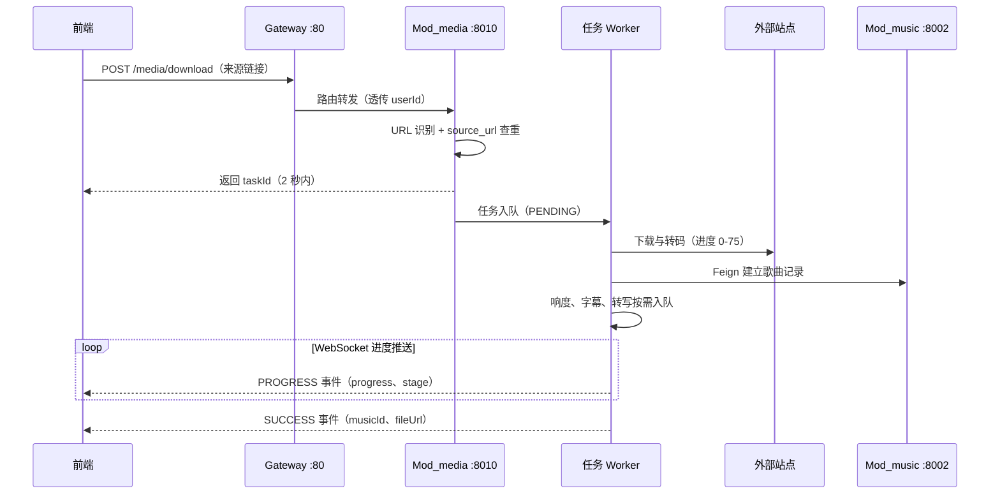

推送消息格式与事件类型：

```json
{
  "eventType": "PROGRESS",
  "data": {
    "status": "RUNNING",
    "progress": 45,
    "stage": "正在下载音频文件...",
    "timestamp": 1692672000000
  }
}
```

| 事件类型 | 触发时机 | 数据内容 |
| --- | --- | --- |
| CONNECTED | 连接成功 | taskId、connectTime |
| PROGRESS | 进度更新 | status、progress、stage |
| SUCCESS | 任务成功 | status、musicId、fileUrl |
| FAILED | 任务失败 | status、error、errorCode |
| CANCELLED | 任务取消 | status、cancelTime |

心跳机制：客户端每 30 秒发送 PING，服务端回 PONG，超时 60 秒断开；客户端断开后每 3 秒自动重连。同时保留 1 秒轮询接口（GET /media/task/{id}）作为兜底通道，两者数据同源。

# 13 前端详细设计

## 13.1 工程结构与组件

工程按 views（页面组件）、components（通用组件）、store（Pinia 状态）、router（路由守卫）、api（Axios 封装）、utils（工具函数）分层。核心通用组件五个：PlayerBar 全局底部播放器、SongList 歌曲列表、CommentSection 评论区、TaskProgressDrawer 任务进度抽屉、MediaUploader 分步上传组件。

## 13.2 播放器组件

以原生 HTML5 audio 元素为核心，集成 wavesurfer.js 波形可视化，LRC 歌词解析后按时间轴同步滚动定位。响度均衡：读取播放接口下发的 volumeGain，按 volume = base × 10^(gain ÷ 20) 换算并限制在 0 到 1 之间后设置音量；无增益数据回退原始音量。播放结束触发上报（播完才计），按循环模式（顺序、单曲循环、列表循环、随机）与智能下一首策略推进队列；播放位置持久化到 localStorage 实现断点续播。

## 13.3 WebSocket 连接管理

```js
const wsUrl = 'ws://host/ws/task/' + taskId;
websocket.onmessage = (event) => {
  const data = JSON.parse(event.data);
  handleTaskProgress(data);
};
websocket.onclose = () => {
  setTimeout(() => reconnect(), 3000);
};
```

任务状态统一收敛到 Pinia 的 taskStore，进度组件订阅渲染；弹层内触发任务操作时事件加 stopPropagation 处理，避免浮层误关闭。

## 13.4 状态管理与路由守卫

Pinia 三个全局 store：userStore（登录态、角色、令牌）、playerStore（播放队列、循环模式、进度）、taskStore（媒体任务与进度）。用户偏好设置缓存 localStorage。路由按角色守卫：未登录仅可访问登录注册与公开浏览页；歌手端页面要求 role 至少为 1；管理端页面要求 role 为 2；路由全部懒加载。

## 13.5 响应式与性能

移动端优先，CSS Grid 与 Flexbox 布局，断点三档：手机小于 768px、平板 768 至 1024px、桌面大于 1024px，配合 Element Plus 响应式组件。性能优化四项：路由懒加载、图片懒加载与 WebP、音频预加载与缓存、搜索输入防抖与滚动节流。

# 14 非功能实现设计

## 14.1 安全实现

| 安全项 | 实现方式 |
| --- | --- |
| SQL 注入防护 | MyBatis 一律参数化占位（#{} 形式），禁止拼接 |
| XSS 防护 | 用户输入内容（标题、评论等）前端输出时转义 |
| 密码安全 | BCrypt 单向加密存储 |
| 传输安全 | 全站 HTTPS |
| 认证与会话 | JWT 过期机制（错误码 2006），登出主动失效 |
| 防刷 | Redis 滑动窗口按用户与接口双维度限流 |
| 敏感数据 | 身份证号加密存储于认证申请表 |
| 审计 | operation_log 记录登录、上传、删除、编辑等关键操作 |

## 14.2 性能实现

| 手段 | 作用点 |
| --- | --- |
| 复合索引 | 全部列表查询（播放历史、评论、歌单保序、举报聚合） |
| Redis 缓存 | 热门榜与推荐结果 10 分钟；会话与验证码全量缓存 |
| 异步隔离 | 媒体任务化，提交 2 秒内返回；播放上报独立于播放链路 |
| 前端优化 | 路由懒加载、图片懒加载、音频预加载、防抖节流 |
| 分页限量 | 搜索与列表统一分页，控制单次返回量 |

## 14.3 熔断降级实现

依赖与配置：

```xml
<dependency>
    <groupId>com.alibaba.cloud</groupId>
    <artifactId>spring-cloud-starter-alibaba-sentinel</artifactId>
</dependency>
```

```yaml
spring.cloud.sentinel:
  transport: { dashboard: "sentinel:8858", port: "8719" }
feign.sentinel.enabled: true
```

Sentinel 规则（控制台可动态调整）如表 14-1 所示。

| 资源 | 规则类型 | 配置值 |
| --- | --- | --- |
| /media/download | QPS 限流 | 2/s（单用户 1/s） |
| Feign:musicService8002 | 异常比例 | 超过 50%（10 秒窗口）熔断 30 秒 |
| Feign:msgService8006 | 慢调用比例 | RT 超 1 秒占 60% 熔断 60 秒 |
| /music/**（网关侧） | QPS 限流 | 200/s 总闸 |

降级策略按语义分层，不一刀切：

| 类型 | 策略 |
| --- | --- |
| 查询类（详情、榜单） | Redis 缓存兜底；无缓存返回"数据暂时不可用" |
| 写入类（Feign 建库失败） | 任务不失败，状态回 PENDING 定时重试（30 秒间隔，至多 3 次） |
| 消息通知失败 | 仅记日志，通知永不阻塞主流程 |
| 外部站点 | 站点级断路器：连续 5 次失败打开、快速失败 10 分钟、半开放行 1 个探测任务、成功关闭 |

Feign fallback 统一在公共模块定义：

```java
@FeignClient(name = "musicService8002", fallback = MusicClientFallback.class)
public interface MusicClient {
    @PostMapping("/music/internal/create")
    Mess create(@RequestBody Song song);
}

@Component
public class MusicClientFallback implements MusicClient {
    public Mess create(Song song) {
        return Mess.fail().mess("音乐服务暂不可用，任务稍后自动重试");
    }
}
```

## 14.4 高可用实现

单点故障分析与对策如表 14-2 所示。

| 组件 | 风险 | 故障影响 | 课设对策 | 生产演进 |
| --- | --- | --- | --- | --- |
| MySQL | 高（唯一状态库） | 全部业务不可用 | 卷持久化 + 每日备份 + 自动重启 | 主从复制 + MHA |
| Redis | 中（缓存与验证码） | 验证码失效、查询变慢 | 降级直查数据库 | 哨兵或集群 |
| Nacos | 中（注册中心） | 已运行服务不受影响，新实例无法注册 | 数据目录挂卷 + 自动重启 | 三节点集群 |
| Gateway | 高（唯一入口） | 全部流量中断 | 自动重启，预留多端口加 Nginx 轮询 | 负载均衡 + 多实例 |
| Mod_media Worker | 中（任务执行器） | 下载与转写中断 | 任务表自愈（10.2 节） | 多实例乐观锁抢任务 |
| 存储卷 /data | 中（文件唯一副本） | 音频封面丢失 | 定期备份至宿主另一目录 | NAS 或对象存储 |
| 外部站点 | 不可控 | 下载与更新失败 | 站点断路器 + 镜像源 + 明确提示 | 同左 |

容灾指标：可用性不低于 99.5%，每日全量备份加实时增量，RPO 不超过 5 分钟，RTO 不超过 1 小时，故障切换不超过 30 秒；生产数据永久保存，日志保留 6 个月，每季度一次容灾演练。

## 14.5 监控告警实现

数据流：各服务（Actuator 与 Micrometer）暴露指标端点，Prometheus（9090）采集，Grafana（3000）看板可视化，Alertmanager（9093）按规则经 SMTP 邮件通知配置的告警邮箱。

业务指标六项：任务量与成功率（media_task_total，Counter）、任务耗时分布（media_task_duration_seconds，Timer）、队列积压（media_task_queue_size，Gauge）、工具健康（media_tool_alive，Gauge）、存活子进程数（media_process_running，Gauge）、工具更新成败（media_tool_update_total，Counter），另有 JVM 与 HTTP 自动指标。

告警规则与业务功能的对应关系如表 14-3 所示。

| 告警规则 | 触发条件 | 用户感知 | 处理措施 | 对应功能 |
| --- | --- | --- | --- | --- |
| TaskQueueBacklog | 队列积压超 10 个持续 2 分钟 | 任务进度变慢 | 扩容 Mod_media | 歌曲上传与下载 |
| ToolUnhealthy | 工具不可用持续 5 分钟 | 下载功能不可用 | 触发工具自动更新 | 下载与转码 |
| ServiceDown | 业务服务不可用持续 30 秒 | 播放不可用 | 自动熔断，降级缓存 | 在线播放 |
| HighJvmGc | 老年代 GC 每秒超过 1 次 | 页面响应变慢 | 重启服务，扩容内存 | 全局性能 |
| TaskFailureSpike | 任务失败率超 20% 持续 5 分钟 | 上传处理频繁失败 | 检查外部站点状态 | 上传与下载 |

# 15 部署方案

## 15.1 开发环境

本地 IDEA 直跑各微服务，Docker 仅运行基础设施（MySQL、Redis、Nacos）；媒体工具统一存放于项目根 tools/ 目录，由 fetch-tools 脚本按清单一键拉取（10.3 节），ToolsLocator 默认探测该目录，系统 PATH 仅作兜底；whisper 模型文件放入 tools/models/（队友间可直接复制共享）。前端 Vite 开发服务器把 API 代理到网关 80 端口。

## 15.2 容器化编排

Docker Compose 骨架：

```yaml
version: "3.8"
services:
  mysql:
    image: mysql:8.0
    command: --character-set-server=utf8mb4
    environment: { MYSQL_ROOT_PASSWORD: "123456", MYSQL_DATABASE: music }
    volumes:
      - mysql_data:/var/lib/mysql
      - ./init:/docker-entrypoint-initdb.d
    ports: ["3306:3306"]
    restart: always
  redis:
    image: redis:6
    ports: ["6379:6379"]
    restart: always
  nacos:
    image: nacos/nacos-server:v2.2.3
    environment: { MODE: standalone }
    ports: ["8848:8848"]
    restart: always
  gateway:
    build: { context: ., dockerfile: Dockerfile.service }
    environment: { SVC: music_gateway, PORT: 80 }
    ports: ["80:80"]
    depends_on: [nacos]
    restart: always
  mod-media:
    build: { context: ., dockerfile: Dockerfile.media }
    volumes: ["media_data:/data", "tools:/opt/tools", "models:/models"]
    depends_on: [mysql, redis, nacos]
    restart: always
  prometheus:
    image: prom/prometheus
    volumes: ["./monitor/prometheus.yml:/etc/prometheus/prometheus.yml",
              "./monitor/rules.yml:/etc/prometheus/rules.yml"]
    ports: ["9090:9090"]
  grafana:
    image: grafana/grafana
    environment: { GF_SECURITY_ADMIN_PASSWORD: admin }
    volumes: ["grafana_data:/var/lib/grafana",
              "./monitor/dashboards:/var/lib/grafana/dashboards"]
    ports: ["3000:3000"]
  alertmanager:
    image: prom/alertmanager
    volumes: ["./monitor/alertmanager.yml:/etc/alertmanager/alertmanager.yml"]
    ports: ["9093:9093"]
volumes: { mysql_data: {}, media_data: {}, tools: {}, models: {}, grafana_data: {} }
```

基础设施统一健康检查与启动顺序依赖（替代 sleep 等待）：

```yaml
mysql:
  healthcheck: { test: ["CMD", "mysqladmin", "ping", "-h", "localhost"],
                 interval: 10s, retries: 10 }
redis:
  healthcheck: { test: ["CMD", "redis-cli", "ping"], interval: 10s, retries: 10 }
nacos:
  healthcheck: { test: ["CMD-SHELL", "curl -f http://localhost:8848/nacos || exit 1"],
                 interval: 15s, retries: 10 }
mod-media:
  depends_on:
    mysql: { condition: service_healthy }
    redis: { condition: service_healthy }
    nacos: { condition: service_healthy }
```

## 15.3 镜像设计

```dockerfile
# Dockerfile.service（通用业务服务模板，JDK 17 基线）
FROM eclipse-temurin:17-jre
ARG SVC
COPY ${SVC}/target/*.jar /app.jar
ENTRYPOINT ["java", "-Xmx512m", "-Dfile.encoding=UTF-8", "-jar", "/app.jar"]

# Dockerfile.media（媒体工具链独立镜像）
FROM eclipse-temurin:17-jre
RUN apt-get update && apt-get install -y --no-install-recommends \
    ffmpeg curl ca-certificates && rm -rf /var/lib/apt/lists/*
ENV TOOLS_DIR=/opt/tools
RUN mkdir -p ${TOOLS_DIR} /data/music /data/image /data/lyric /data/task /models \
    && curl -L https://github.com/yt-dlp/yt-dlp/releases/latest/download/yt-dlp_linux \
       -o ${TOOLS_DIR}/yt-dlp && chmod +x ${TOOLS_DIR}/yt-dlp
COPY Mod_media/target/*.jar /app.jar
ENTRYPOINT ["java", "-Xmx1g", "-Dfile.encoding=UTF-8", "-jar", "/app.jar"]
```

容器工具链关键约束：Linux 容器不能执行 Windows 可执行文件，因此 ffmpeg 经镜像内包管理安装、yt-dlp 下载 Linux 版本；whisper 模型文件与 cookies 文件是跨平台数据文件，挂载复用即可（开发机已有模型可直接挂载宿主目录）。

## 15.4 数据初始化

首次部署由 MySQL 容器自动执行 init.sql（挂载 ./init 目录实现）。内容依次为：19 张表完整 DDL（第 3 章）；默认管理员账号（admin，密码 admin123 经 BCrypt 加密，role=2）；七项默认系统配置（表 11-1）；默认音乐分类（流行、摇滚、民谣、电子等）与示例歌曲数据。首次启动流程：容器启动、MySQL 初始化、执行 init.sql、业务服务启动（健康检查依赖保证顺序）、系统就绪。

## 15.5 Windows 环境注意事项

Docker Desktop 采用 WSL2 后端；容器互连时配置中的 localhost 一律改为服务名（mysql、redis、nacos），这是容器化改造最高频的错误；MySQL 强制 utf8mb4 字符集；JVM 统一 -Dfile.encoding=UTF-8（Windows 下尤其重要）；上传服务存储路径从本地盘符改为数据卷 /data。

# 16 开发阶段划分

| 阶段 | 内容 |
| --- | --- |
| P1 | Compose 基建：MySQL、Redis、Nacos 与现有服务容器化跑通（localhost 改服务名改造） |
| P2 | Mod_media：进程执行器、工具定位器、下载管线、412 风控应对 |
| P3 | 响度分析、字幕、AI 转写、工具与模型管理（含自动更新） |
| P4 | 播放统计体系与设置中心 |
| P5 | 监控体系：指标、看板、告警联调 |
| P6 | Sentinel 熔断限流、任务自愈、故障演练 |

编码与联调必查的经验约束（源项目实测教训）：子进程调用必须全异步（同步会冻结整个服务）；命令必须数组参数（拼接遇特殊字符必错）；B 站 412 根因是旧版 yt-dlp 加缺 cookie，两层防护缺一不可；ffmpeg 响度结果在 stderr；大模型文件必须确认后才下载且需体积校验；取消任务必须结束进程并清理临时文件；JVM 与脚本统一 UTF-8；删除资源必须删全套；长任务必须进度可见且可取消；前端弹层事件需 stopPropagation 处理。

# 17 微信小程序端（uniapp）与微信登录

## 17.1 端与工程

微信小程序为主目标端（体验版演示，不做公开发布），Vue3 + Vite 版 uni-app，工程 `uniapp/`（与 backend/frontend 平级独立仓库）。所有 @dcloudio/\* 锁同一版本（`3.0.0-5020420260813003`）。开发 `npm run dev:mp-weixin` 产物 `dist/dev/mp-weixin` 导入微信开发者工具；`manifest.json` 的 `mp-weixin.appid` 为小程序 AppID。

## 17.2 微信一键登录链路

```
小程序 wx.login() 取 code（一次性，5 分钟）
  → POST /api/v1/user/wx/login（网关 WHITELIST 放行）
  → Mod_login WxAuthServiceImpl 调 jscode2session（appid + app-secret）换 openid
  → user.wx_openid 命中 → 直接签发 JWT（与口令登录同构：session:{uid}、登录日志、auth floor 兼容）
  → 未命中 → 自动建号：username=wx_{openid}、占位邮箱 wx_{openid}@wx.placeholder（满足 NOT NULL+唯一）、
    随机 UUID 密码（不可口令登录）、昵称"悦友"xxxx；并发首登靠唯一索引兜底后重查
```

- 迁移 `V6__user_wx_openid.sql`（Mod_songList Flyway，全库迁移约定位置）：`user` 加 `wx_openid VARCHAR(64) NULL` + 唯一索引，已实跑验证。
- 绑定/解绑：`POST / DELETE /api/v1/user/wx/bind`（登录态），供已有账号在设置里绑定微信；openid 已被他人绑定报 2009。
- 错误码：2008 微信登录凭证无效（jscode2session errcode≠0）、2009 微信已绑定其他账号。
- **AppSecret 不进前端**：仅存 Mod_login 的 gitignored `application-secret.yml`（`wx.app-secret`）或环境变量 `WX_APP_SECRET`，yml 默认值为空。

## 17.3 小程序端约束（与 Web 端差异）

- 请求封装 `src/utils/request.js`：BASE_URL 走电脑局域网 IP（真机与电脑同一 WiFi），自动带 Bearer token；2006 清登录态回登录页；登录/发 JWT/错误码语义与 Web 端完全一致。
- 演示全链路无需公网/备案：真机开"开发调试→不校验合法域名"；注意 Windows 防火墙放行 8080。
- 音频播放将用 BackgroundAudioManager（后台/锁屏播放），Web 端 Web Audio 频谱在小程序不可用（后续以 CSS 动画降级）。
